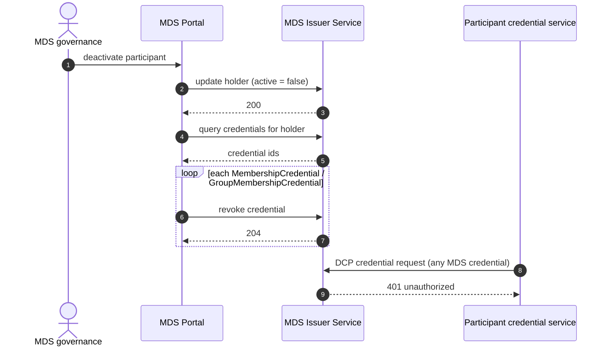
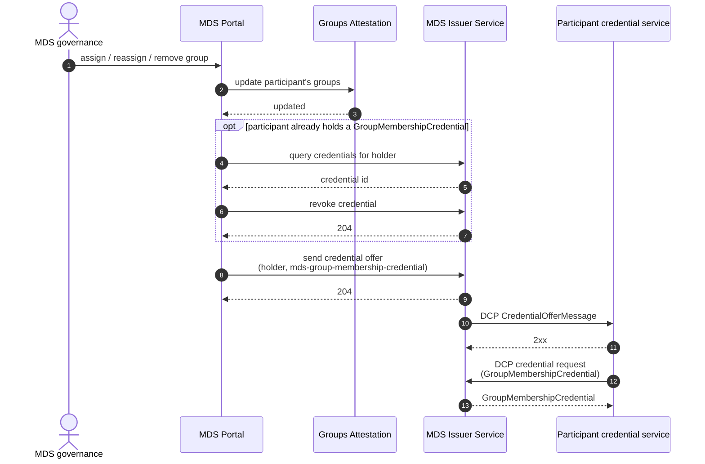

---
---

# MDS Verifiable Credentials — 2026/1

> **Status — DRAFT.** This document specifies the verifiable credentials of profile version `2026/1` of the Mobility Data Space dataspace profile. It is not yet released.

## 1. Scope

MDS-specific verifiable credentials a participant presents under the Decentralized Claims Protocol to satisfy MDS policy constraints: for each credential type, what it attests, who may issue it, and the schema it MUST follow.

## 2. Common requirements

| Requirement | Rule |
|---|---|
| Issuer | `did:web` DID under a domain controlled by the MDS credential issuer. A verifier **MUST** reject a credential whose issuer is not in its configured set of trusted issuers for the credential type — a valid signature alone is not sufficient. |
| Format | Credentials are W3C VC Data Model 2.0, secured as JOSE (`VC2_0_JOSE`). |
| Subject binding | `credentialSubject.id` **MUST** be the holder's DID and **MUST** equal the DID that authenticates in the presentation exchange. |
| Participant identifier | Every subject carries `participantId`, assigned at onboarding, bound to the `ParticipantId` policy operand. |
| Subject schema | Every credential **MUST** carry a `credentialSchema` of type `JsonSchema` whose `id` is the JSON Schema of its subject, published under `https://w3id.org/mobility-dataspace/2026/1/credentials/`. A verifier resolves it and rejects a credential whose `credentialSubject` does not validate; a credential that omits the property is not checked at all. |
| Active membership | The issuer **MUST NOT** issue any MDS credential to a holder whose membership is not active. |

## 3. Credentials

### 3.1 MembershipCredential

Attests that the subject is a participant of the Mobility Data Space. 
It is the base credential of the dataspace: a participant holds exactly one, and every other MDS credential presupposes it. 
Issued by the MDS credential issuer once onboarding completes. 
`participantId` is taken from the holder record registered at the issuer during onboarding. 
Membership is evidenced by holding a valid, unrevoked MembershipCredential. When a membership is deactivated, the issuer **MUST** revoke every outstanding MDS credential of that holder.

### 3.2 GroupMembershipCredential

Attests that the subject belongs to one or more MDS groups. 
A group is a set of participants maintained by MDS governance for policy targeting, so a provider can restrict an offer to a category of consumers without enumerating their participant identifiers. 
The set of valid identifiers is maintained by MDS governance and is not fixed by this profile version.

`groups` is a **string** holding the subject's group identifiers separated by commas (for example `"public-transport,parking-operators"`). Consumers **MUST** split it on `,` to obtain the individual identifiers; a group identifier therefore **MUST NOT** contain a comma.

A participant holds at most one GroupMembershipCredential, listing all its groups. 
When a participant's group set changes, the issuer **MUST** revoke the existing credential and offer a replacement (§6). It is meaningful only alongside a valid MembershipCredential; a verifier **MUST NOT** accept it on its own as evidence of MDS membership.

## 4. Policy operand bindings

| Operand | Credential | Subject property |
|---|---|---|
| `ParticipantId` | `MembershipCredential` | `participantId` |
| `Membership` | `MembershipCredential` | — (presence of a valid, unrevoked credential) |
| `Group` | `GroupMembershipCredential` | `groups` (comma-separated) |

## 5. MDS Credential definitions

> **Note — active membership.** The issuer keeps, for every registered participant, whether its membership is currently active; this state is maintained by the MDS Portal and is not part of any issued credential. Every credential request, including one that answers an offer, is accepted only while the membership is active. Revocation (§6.1) invalidates the credentials already issued; this check prevents new ones from being issued once a membership has ended.

```json
{
  "id": "mds-membership-credential",
  "credentialType": "MembershipCredential",
  "format": "VC2_0_JOSE",
  "validity": 31536000,
  "attestations": ["mds-membership-attestation"],
  "rules": [
    { "type": "expression", "configuration": { "claim": "active", "operator": "eq", "value": true } }
  ],
  "additionalContext": [
    "https://w3id.org/mobility-dataspace/2026/1/credentials/context.jsonld"
  ],
  "jsonSchemaUrl": "https://w3id.org/mobility-dataspace/2026/1/credentials/MembershipCredential.schema.json",
  "mappings": [
    { "input": "participantId", "output": "credentialSubject.participantId", "required": true }
  ]
}
```

```json
{
  "id": "mds-group-membership-credential",
  "credentialType": "GroupMembershipCredential",
  "format": "VC2_0_JOSE",
  "validity": 31536000,
  "attestations": ["mds-membership-attestation", "mds-group-membership-attestation"],
  "rules": [
    { "type": "expression", "configuration": { "claim": "active", "operator": "eq", "value": true } }
  ],
  "additionalContext": [
    "https://w3id.org/mobility-dataspace/2026/1/credentials/context.jsonld"
  ],
  "jsonSchemaUrl": "https://w3id.org/mobility-dataspace/2026/1/credentials/GroupMembershipCredential.schema.json",
  "mappings": [
    { "input": "participantId", "output": "credentialSubject.participantId", "required": true },
    { "input": "groups", "output": "credentialSubject.groups", "required": true }
  ]
}
```

## 6. Credentials lifecycle

The MDS Portal drives every change to an issued credential. It revokes the outstanding credentials and, where a replacement is due, asks the issuer to send a DCP Credential Offer; the holder answers the offer with a standard credential request, without any action by the participant.

The holder's Credential Service **MUST** support the DCP offer endpoint and initiate a credential request on receipt of an offer.

### 6.1 Membership deactivation



### 6.2 Group change


