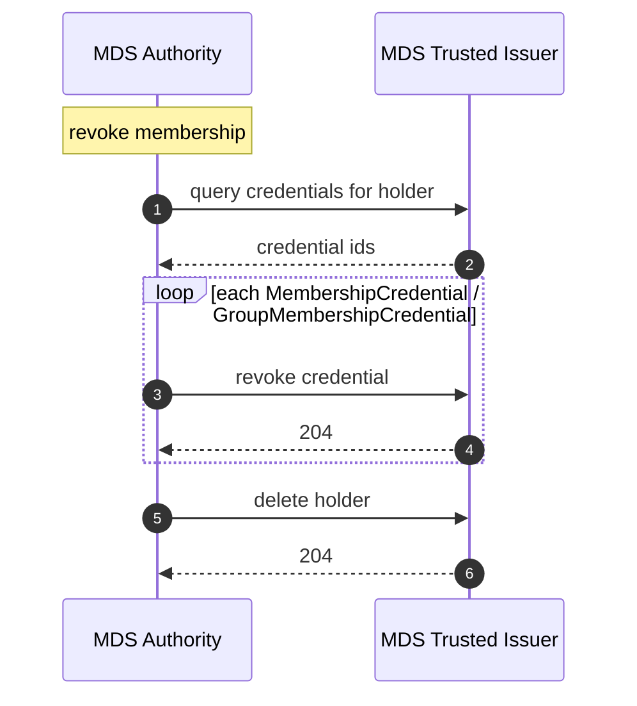
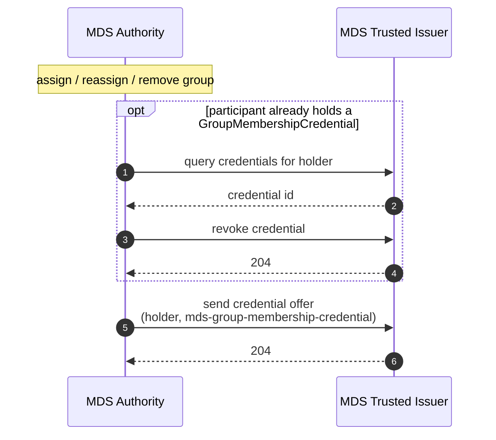

---
---

# MDS Verifiable Credentials — 2026/1

> **Status — DRAFT.** This document specifies the verifiable credentials of profile version `2026/1` of the Mobility Data Space dataspace profile. It is not yet released.

## Introduction

This document specifies the MDS verifiable credentials: what each states, what an MDS Trusted Issuer issues, how a participant verifies it, and how the MDS Authority keeps it current. The MDS policy operands that read these credentials are specified in the [MDS ODRL Profile](https://mobility-data-space.github.io/mds-profile/2026/1/policy/).

## Issued Credentials

An MDS Trusted Issuer **MUST** issue MDS credentials that meet these requirements:

| Requirement | Rule |
|---|---|
| Format | W3C VC Data Model 2.0, secured as JOSE (`VC2_0_JOSE`). |
| Context | `@context` is `https://www.w3.org/ns/credentials/v2` followed by `https://w3id.org/mobility-dataspace/2026/1/credentials/context.jsonld`. The MDS credentials context defines only the MDS terms and is `@protected`. |
| Subject | `credentialSubject.id` is the holder's `did:web` DID ([Participant DID document](https://mobility-data-space.github.io/mds-profile/2026/1/#a-participant-did-document)). |
| Subject schema | `credentialSchema` is of type `JsonSchema`, with the `id` of the JSON Schema of its subject, published under `https://w3id.org/mobility-dataspace/2026/1/credentials/`. |
| Issuer | an MDS Trusted Issuer ([MDS Trusted Issuers](https://mobility-data-space.github.io/mds-profile/2026/1/#mds-authority-and-issuers-trusted-by-mds)). |

## Credentials Verification

An MDS credential is a credential issued by an MDS Trusted Issuer and found valid under DCP verification. A credential of the same type name from any other issuer is not an MDS credential. A verifier **SHOULD** also check its type:

| Requirement | Rule |
|---|---|
| Issuer (**MUST**) | its issuer is an MDS Trusted Issuer. |
| Type (**SHOULD**) | `MembershipCredential` or `GroupMembershipCredential` in the MDS credentials namespace. |

A verifier **MUST** evaluate an MDS credential only if its `credentialSubject.id` is the DID of the authenticated counterparty.

A verifier **MUST NOT** evaluate an MDS credential that is revoked or outside its validity period.

## Credentials

### MembershipCredential

- States that the subject is a participant of the Mobility Data Space.
- It is the default credential of the dataspace: every other MDS credential presupposes it.
- Issued by an MDS Trusted Issuer once onboarding completes.
- Membership is evidenced by holding an MDS MembershipCredential ([Credentials Verification](#credentials-verification)).

### GroupMembershipCredential

- States that the subject belongs to one or more MDS groups.
- A group is a set of participants maintained by the MDS Authority for policy targeting, so a provider can restrict an offer to a category of consumers without enumerating their DIDs.
- The set of valid identifiers is maintained by the MDS Authority and is not fixed by this profile version.

`groups` is a **string** holding the subject's group identifiers separated by commas (for example `"public-transport,parking-operators"`). Consumers **MUST** split it on `,` to obtain the individual identifiers.

A GroupMembershipCredential is issued only to MDS members and lists all the groups of its subject. When a participant's group set changes, it is revoked and replaced (see [Credentials lifecycle](#credentials-lifecycle)).

## Policy operand bindings

| Operand | Credential | Read |
|---|---|---|
| `Membership` | `MembershipCredential` | — (presence of an MDS MembershipCredential) |
| `ParticipantId` | `MembershipCredential` | `credentialSubject.id` |
| `Group` | `GroupMembershipCredential` | `groups` (comma-separated) |

## MDS Credential definitions

> **Note — membership.** The MDS Trusted Issuers issue credentials only to registered holders; they keep no membership status. The MDS Authority decides membership and groups: it registers a holder when it onboards the participant and deletes it when the membership is revoked, so a credential request from a former member fails because its holder is unknown.

```json
{
  "id": "mds-membership-credential",
  "credentialType": "MembershipCredential",
  "format": "VC2_0_JOSE",
  "validity": 31536000,
  "attestations": ["mds-membership-attestation"],
  "additionalContext": [
    "https://w3id.org/mobility-dataspace/2026/1/credentials/context.jsonld"
  ],
  "jsonSchemaUrl": "https://w3id.org/mobility-dataspace/2026/1/credentials/MembershipCredential.schema.json",
  "mappings": []
}
```

```json
{
  "id": "mds-group-membership-credential",
  "credentialType": "GroupMembershipCredential",
  "format": "VC2_0_JOSE",
  "validity": 31536000,
  "attestations": ["mds-membership-attestation", "mds-group-membership-attestation"],
  "additionalContext": [
    "https://w3id.org/mobility-dataspace/2026/1/credentials/context.jsonld"
  ],
  "jsonSchemaUrl": "https://w3id.org/mobility-dataspace/2026/1/credentials/GroupMembershipCredential.schema.json",
  "mappings": [
    { "input": "groups", "output": "credentialSubject.groups", "required": true }
  ]
}
```

## Credentials lifecycle

The MDS Authority drives every change to an issued credential. It revokes the outstanding credentials and, where a replacement is due, asks an MDS Trusted Issuer to offer it to the holder.

The holder's Credential Service **MUST** support the DCP offer endpoint and initiate a credential request on receipt of an offer.

### Membership revocation

Revoking a membership means revoking every outstanding MDS credential of the holder, then deleting the holder at the MDS Trusted Issuers.



### Group change


